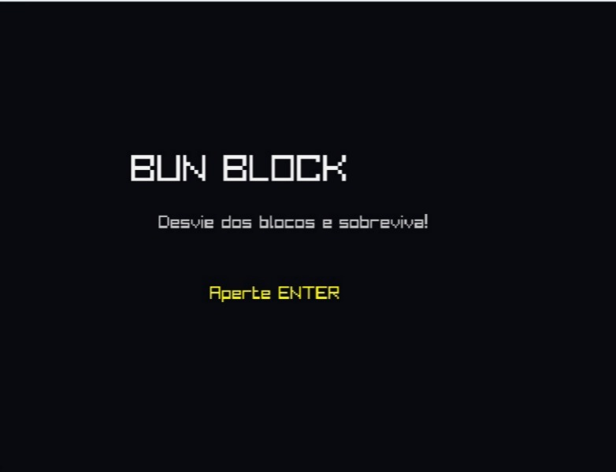

# Bun Block

## Integrantes
- Julia Caillot de Souza — GitHub: 26033023@uepg.br
- Janaina Rodrigues — GitHub: 26008023@uepg.br
- Gabriel Vieira Feldhaus — GitHub: 26050723@uepg.br

## Instalação

 A biblioteca usada foi a Raylib, a versão utilizada e que deve ser instalada é deste github, https://github.com/skeeto/w64devkit/releases, instale a opção w64devkit-x64-2.11.0.7z.exe e extraía. Agora, vá em seu Codeblocks, instale a file Versão 1.0 deste github, e abra ela no codeblocks. Agora, vá em Settings, clique em Compiler, e entre em Toolchain executables, vá em Compiler's installation directory e mude para pasta extraida, tenha certeza que não ter o \bin no final, mude o Make program para make.exe e aperte Ctrl + F11 no seu projeto.

## Ferramentas Usadas
 BFXR, para fazer os sons do jogador e dos blocos caindo.
 FreeMusicArchive, para a musica do background.
 Raylib.com, o site oficial do raylib, o cheatsheet foi utilizado bastante.
 Gemini, ajudou achar erros e compactar o código.
